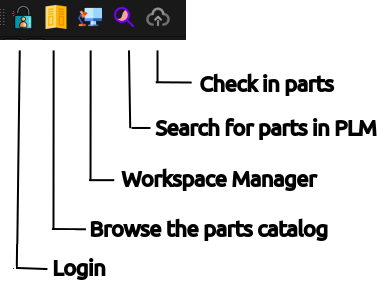
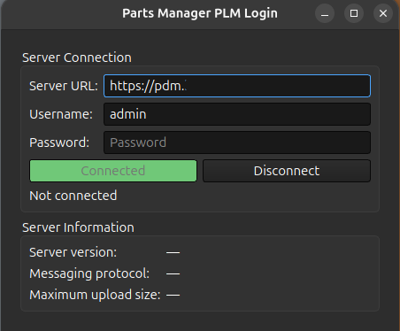
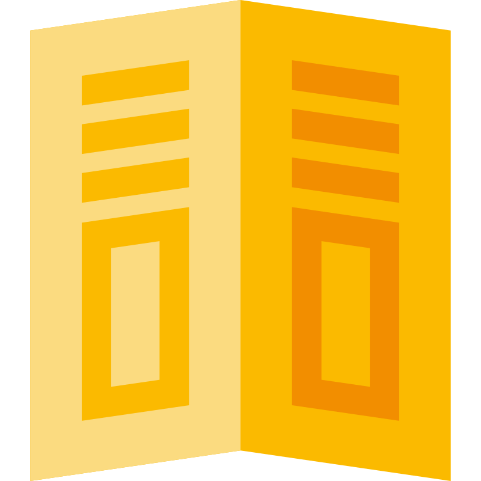
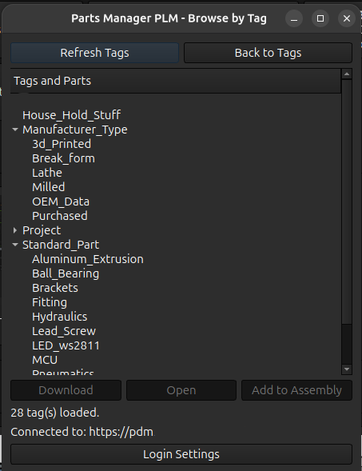
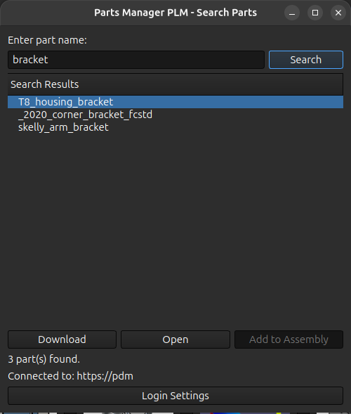
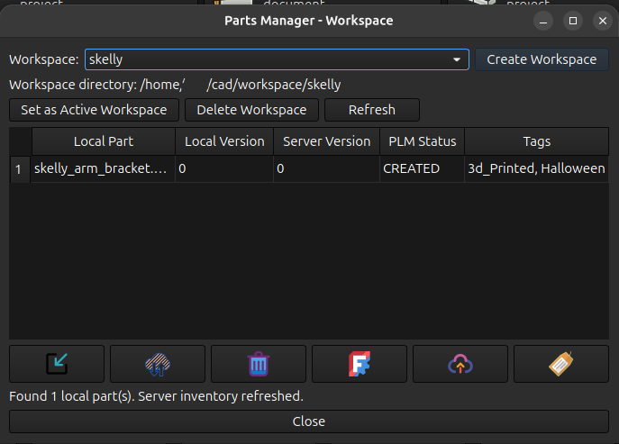
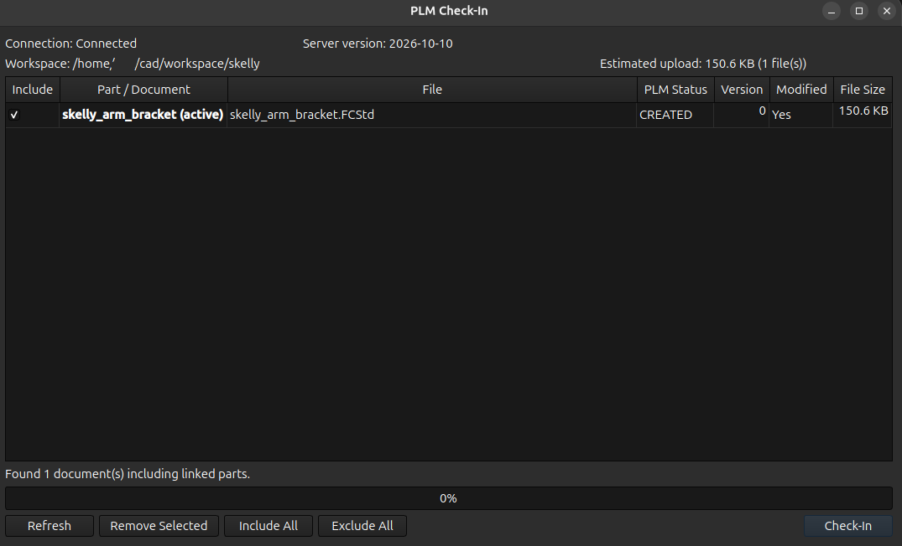
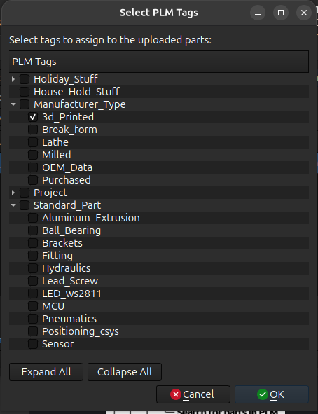

# Parts Manager PLM workbench for FreeCAD

This workbench contains tools to interact with Part Manager Plm app you can find under the 

https://github.com/redshift2/Part-Manager_PLM

## Installation

Workbench dependencies should be managed directly with FreeCAD, install both protobuf and requests Python modules.

This Workbench is part of the [FreeCAD addons](https://github.com/FreeCAD/FreeCAD-addons) collection and can be simply installed from the Addons manager.

## Connect to the Server

Under Freecad:

* Select the Parts Manager PLM Workbench
* Select a file you need to upload (if not already done, save it before)

### Workbench Buttons

 

##   Login Screen

The first time, you will be prompted for entering the server URL, along with your user credentials:

1. Server URL Input
2. User Login Input
3. User Password Input
4. Path where model from the server will be put

Clicking on **Connect** Button.

If the **Connect** Button turns disabled, you are connected to your PLM Server.

##   Parts Catalog Dialog Window

This dialog window allows the engineer to search for parts that have tags assigned to them in the PLM server. 
A useful function when searching for standard parts for a project. 
The layout, names, and hierarchy of the tags is defined on the server side.

Selecting the tag will return all parts that have that tag assigned to it.
Parts with multiple tags can be found by searching for any one of their tags, so the object will be returned if at least one matching tag is searched.

For example. A M6x25 screw has tags, Purchased and Screw assigned to it. Searching the tag screw will return the part

###   Search Part By Name

This function will download parts from the server. You have 3 options. 

**Download** Download the part to the workspace setup in the workspace manager

**Open** Download and open this directly in Freecad

**Add to Assembly** This button is only active if you are in a assembly. It will download the part from the server and auto add it to the current assembly

##  Workspace Manager

This is a power dialog window. First of all this is where you create a workspace. A workspace is the location of your local computer that parts will be download from the PLM sever

All the parts in the local workspace will be displayed in the table. The local version of the part is the version that was last downloaded from the server. If there is a mis-match between the local version and the server version the mis-match will be highlighted in red.

Mis-match is part version can occur when a part is changed on the server but the local version is not the latest version.

###   Import to Workspace
opens a dialog window that allows you select parts on your local computer and move them to the workspace directory

###   Sync Workspace
Opens a dialog box to show any parts that the server version is greater than the local version and will download any out of syn parts

###   Remove from Workspace
Delete the selected part(s) from the workspace. The entire row must be selected. In the above example workspace this action would be performed by select the '1' beside the locat part number

###   Open in Freecad
Opens the selected part In Freecad. The entire row must be selected. In the above example workspace this action would be performed by select the '1' beside the locat part number

###   Upload to Server

The dialog allows you to select the parts that you wish to upload to the server. It will provide an estimate upload size.
you can select multiple parts to upload if allowed by the server. Only modified parts can be uploaded to the server

###   Set the Part TAG
This will open a dialog window and allow you to assign tags to the selected part(s)

## Download a previous version

From your Intranet, click on PLM icon, then you will see a list of model.

1. Help
2. Filter
3. Model Table
4. Access Duplicated Parent Part
5. Main Menu 
   1. **Parts**: Either in CREATED or FREE Status
   2. **Top Assemblies**: Flat table of Files with Links, in CREATED or FREE Status
   3. **Locked Parts**: Either OBSOLETED or LOCKED Status

Search using filters the one you are interested in, then click on the **eye** icon.

1. Selected Model preview (When the model was uploaded)
2. Hierarchical Features Linked from other files with versions
3. Part Data
4. Download Last Part version, with its dependencies, in a zip file
5. 3D Viewer
6. Edit Access Right / Status
7. Edit Tags (tags are managed in Attachment app)

Here you can either:

* Download the latest version
* Add comment OR change model status
* Download a previous version
* Attach a file (in Attachments tab)

1. Differences between versions
2. Current Status
3. Status Changes date
4. Preview a precise version

For more complex model, you can access linked files or links pointing to this model via Hierarchy tab.

